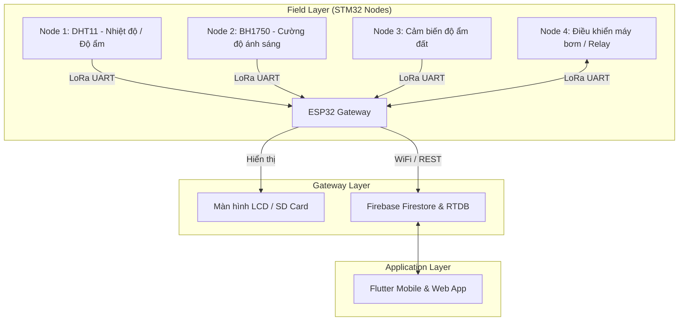

# 🌾 Smart Farm IoT LoRa System

Hệ thống giám sát và điều khiển nông nghiệp thông minh không dây từ xa, ứng dụng công nghệ **LoRa**, **ESP32 Gateway**, **STM32 Sensor Nodes** và ứng dụng di động **Flutter**.

---

## 🏗️ Kiến trúc hệ thống (Architecture)



---

## 📁 Cấu trúc thư mục (Project Structure)

| Thư mục | Nền tảng / Công nghệ | Vai trò |
| :--- | :--- | :--- |
| **`stm32 node/`** | STM32CubeMX, Keil MDK-ARM (C) | Firmware cho 4 node cảm biến và chấp hành (DHT11, BH1750, Độ ẩm đất, Relay điều khiển bơm) qua LoRa. |
| **`esp32_agrr/`** | PlatformIO, Arduino C++ | Gateway trung tâm: nhận dữ liệu LoRa từ các node, ghi log thẻ SD, hiển thị LCD và đẩy dữ liệu lên Firebase. |
| **`AppESP32/`** | Flutter (Dart) | Ứng dụng di động & Web: theo dõi biểu đồ cảm biến thời gian thực, cài đặt ngưỡng cảnh báo và hẹn giờ tưới tự động. |

---

## 🛠️ Công nghệ sử dụng (Tech Stack)

* **Vi điều khiển & Phần cứng:** STM32F103C8T6 (BluePill), ESP32 DevKit, Module LoRa (UART).
* **Cảm biến:** DHT11, BH1750, cảm biến điện dung đo độ ẩm đất, module Relay 5V/12V.
* **Firmware:** Keil uVision (STM32 HAL Driver), PlatformIO (ESP32 Arduino Framework).
* **Cloud & Cơ sở dữ liệu:** Firebase Cloud Firestore & Realtime Database.
* **Mobile / Web App:** Flutter Framework (State Management, Charts, Firebase SDK).

---

## ⚙️ Hướng dẫn cài đặt nhanh (Quick Start)

### 1. ESP32 Gateway (`esp32_agrr/`)
1. Cài đặt extension **PlatformIO** trong VS Code.
2. Mở file [esp32_agrr/src/config.h](esp32_agrr/src/config.h) và [esp32_agrr/src/firestore.cpp](esp32_agrr/src/firestore.cpp).
3. Cập nhật thông tin WiFi và Firebase của bạn:
   ```c
   #define FIREBASE_HOST "your-project-id-default-rtdb.firebaseio.com"
   #define FIREBASE_AUTH "your-database-secret"
   ```
4. Build và nạp firmware cho ESP32.

### 2. STM32 Sensor Nodes (`stm32 node/`)
1. Mở từng dự án tương ứng (`bh1750`, `do_am_dat`, `gpio`, `stm32_dht11`) bằng **Keil MDK-ARM (uVision)**.
2. Biên dịch (Build) và nạp cho vi điều khiển STM32F103 bằng ST-Link.

### 3. Flutter App (`AppESP32/`)
1. Đảm bảo đã cài Flutter SDK (`>= 3.0.0`).
2. Tải file `google-services.json` từ Firebase Console và đặt vào `AppESP32/android/app/`.
3. Chạy lệnh:
   ```bash
   cd AppESP32
   flutter pub get
   flutter run
   ```

---

## 📄 License
Dự án được phát triển phục vụ mục đích nghiên cứu, học tập và ứng dụng nông nghiệp công nghệ cao.
